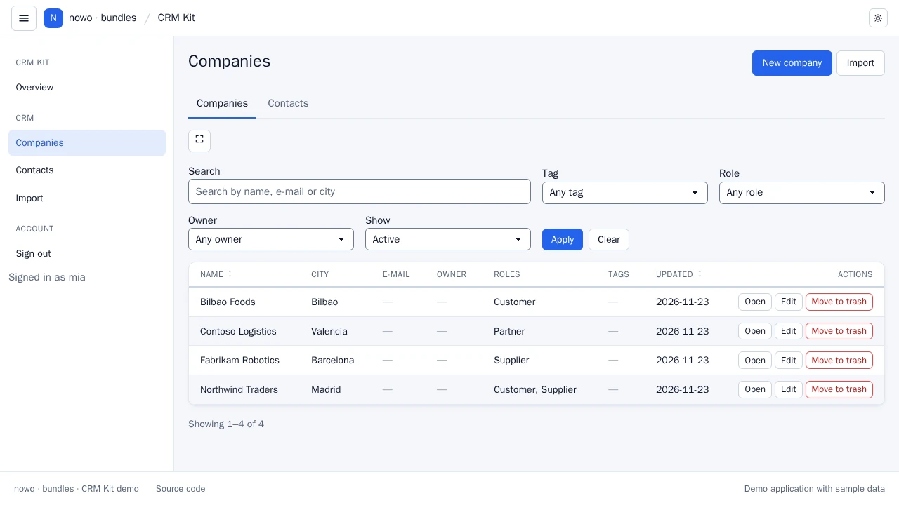
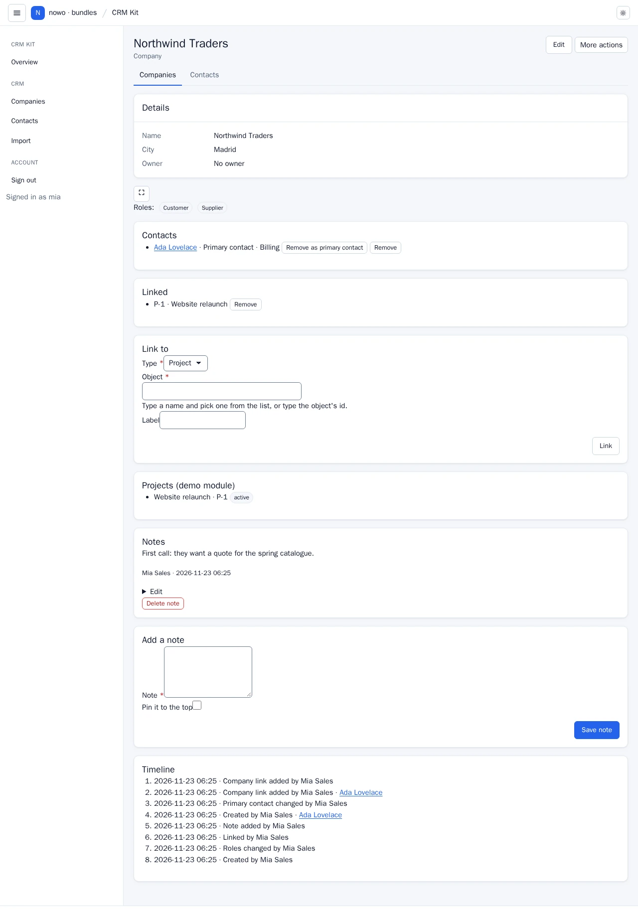

# CRM Kit Bundle

[](https://github.com/nowo-tech/CrmKitBundle/actions/workflows/ci.yml) [](https://packagist.org/packages/nowo-tech/crm-kit-bundle) [](https://packagist.org/packages/nowo-tech/crm-kit-bundle) [](LICENSE) [](https://php.net) [](https://symfony.com) [](https://github.com/nowo-tech/CrmKitBundle) [](#tests-and-coverage)

> ⭐ **Found this useful?** Install it from [Packagist](https://packagist.org/packages/nowo-tech/crm-kit-bundle) and give it a star on [GitHub](https://github.com/nowo-tech/CrmKitBundle): it helps us maintain and improve the project.

**A CRM for Symfony applications: companies and contacts with owners, tags, custom fields, notes, an activity
timeline, CSV / vCard import and export, duplicate merging, GDPR consent / export / erasure and a 360° record page that
shows your own modules through host panels. Tenant-aware, deny by default, on a private entity manager, with a UiKit +
FormKit UI.**

**Standard Symfony by default, DDD / hexagonal opt-in:** zero configuration in a standard project; public ports are
interfaces and value objects with no Symfony, Doctrine or HTTP types, the bundle-owned tables are mapped in XML and
referenced by id, and the bundle never flushes your EntityManager.

> **Status: 0.10.x.** Companies and contacts with roles, purposes and affiliations (phase A), the pipeline with deal
> and party funnels and the JSON API (phase B, 0.3.0), and the HubSpot import (0.10.0) are released. Tasks and
> agenda, quotes, invoices, a customer portal, scoring, segments, informative circulars and reports follow phase by
> phase from [docs/CONTRACT.md](docs/CONTRACT.md)
> ([docs/ROADMAP.md](docs/ROADMAP.md)). Usage: [docs/USAGE.md](docs/USAGE.md).

> **Compatible with Symfony 7.4, 8.0 and 8.1** · PHP 8.2+ (Symfony 8.x requires PHP 8.4+)


This bundle is **FrankenPHP worker mode friendly** (kernel kept alive and not reset).

<table>
  <tr>
    <td align="center" width="50%">
      
      <br /><sub>Companies list: filters, party roles and row actions</sub>
    </td>
    <td align="center" width="50%">
      
      <br /><sub>360° record page: contacts, host links and panels, notes and timeline</sub>
    </td>
  </tr>
</table>

## Features

Phase A (0.1.0), always on when the bundle is enabled:

- **Companies and contacts**: core fields, owners (people of your application), tags, custom fields per tenant
  (text, textarea, number, date, boolean, choice, url, email), trash with restore and purge.
- **Party roles** (0.2.0): one entity for customers, suppliers, partners and so on: a company or a contact holds any
  number of roles from a configurable catalogue (`customer`, `supplier`, `partner`; `distributor` opt-in), filtered
  in the lists, imported and exported.
- **Affiliations**: a contact belongs to any number of companies, each with a role, one of them primary; a company has
  at most one **primary contact**, and each affiliation says what the contact is for (**purposes**: billing, orders,
  technical, general; configurable).
- **Notes and timeline**: plain-text notes (pinned first) and an append-only activity timeline per record; a company's
  timeline includes its contacts' entries; your application adds its own entries.
- **Activities** (0.11.0, opt-in `activities.enabled`): log calls, meetings and e-mails on companies and
  contacts (shown on their companies and open deals too), an activity feed filtered by kind and person, pinned notes,
  @mentions with MilkdownEditor and NotifyKit, your own items on the feed (host activity source), meetings on
  TaskBoard's calendar and as `.ics`.
- **E-mail templates** (0.13.0, opt-in `templates.enabled`, with MailKit >= 2.8): personal and shared
  templates and snippets with `contact.*`, `company.*`, `deal.*` and `me.*` placeholders (closed, never evaluated), a
  consent purpose per template, and *Write e-mail* on a contact's page (sent mail logged as an `email` activity).
- **360° page**: details, contacts / companies, host links (your projects, tickets and so on, referenced by id and
  resolved by your code on every view), host panels (your read models), notes, timeline, possible duplicates, consents.
- **Import and export**: CSV (`,` or `;`) and vCard 3.0 / 4.0 import in a modal from the lists (0.4.0; the import page
  stays the no-JS fallback) with a preview, an editable column mapping and a duplicate policy; CSV export of a filtered list (formula cells neutralised) and a vCard 4.0 per contact.
- **HubSpot import** (0.10.0, opt-in): companies, contacts, associations, owners and lists from a HubSpot
  account through a service key (or a legacy private app token) sealed at rest; re-runs update instead of duplicating
  (USAGE, "HubSpot import").
- **Duplicates and merging**: hints by name, website domain and tax id (companies) or sort name (contacts); a
  field-by-field merge that moves every child row and keeps a snapshot.
- **GDPR**: consent per contact and purpose (append-only), a JSON export, an erasure that keeps consent proof without
  its evidence, and a retention purge.
- **Plan limits**: atomic counters per tenant, so two creates at the limit can never both pass.
- **Header search**: SearchKit groups of companies, contacts and deals when `nowo-tech/search-kit-bundle` ^1.9 is installed.
- **Private entity manager** `nowo_crm_kit`, declared by the Flex recipe, so the bundle never flushes the host's
  unit of work; every write is a transaction-doctrine write unit (409 with `CONFLICT_001` / `CONFLICT_002`).

Built phase by phase: **companies and contacts (0.1)** → **roles and purposes (0.2)** → funnels (0.3) → tasks and
agenda (0.4) → quotes (0.5) → invoices (0.6) → customer portal (0.7) → scoring (0.8) → lists and segments (0.9) →
informative circulars (0.10) → reports (1.0).

## Installation

```bash
composer require nowo-tech/crm-kit-bundle
```

See [docs/INSTALLATION.md](docs/INSTALLATION.md).

## Requirements

- PHP >= 8.2, < 8.7 (Symfony 8.x needs PHP 8.4+)
- Symfony 7.4, 8.0 or 8.1
- Doctrine DBAL 3.8+ / 4 and ORM 3.7+ with DoctrineBundle
- `nowo-tech/ui-kit-bundle` ^2.55, `nowo-tech/form-kit-bundle` ^2.23, `nowo-tech/transaction-doctrine` ^1.6,
  `nowo-tech/transaction-contract` ^1.0
- Optional: `nowo-tech/search-kit-bundle` ^1.9 (header search; SearchKit needs PHP >= 8.3), `symfony/security-bundle`
  (default access checker and actor directory)

## Configuration

```yaml
# config/packages/nowo_crm_kit.yaml
nowo_crm_kit:
    doctrine:
        entity_manager: nowo_crm_kit
    security:                  # REQ-UI-002: also lock the path with access_control in security.yaml
        access_roles: [ROLE_USER]
        manage_roles: [ROLE_USER]
        settings_roles: [ROLE_ADMIN]
        export_roles: [ROLE_ADMIN]
        erase_roles: [ROLE_ADMIN]
    ui:
        enabled: true
```

```yaml
# config/routes/nowo_crm_kit.yaml
nowo_crm_kit:
    resource: .
    type: nowo_crm_kit_ui
    prefix: /admin
```

Every key of the contract is already accepted (strict tree): [docs/CONFIGURATION.md](docs/CONFIGURATION.md).

## Demo

`demo/symfony7` (Symfony 7.4, http://localhost:8263) and `demo/symfony8` (Symfony 8.1, http://localhost:8262):
FrankenPHP worker mode, MySQL, UiKit + FormKit, in-memory users `ana`, `mia` and `admin` (password `demo`);
`make -C demo up-symfony8`, then `make test-e2e` for the Playwright run and `make demo-screenshots` (fresh stack) to
refresh `docs/images/demo/*.webp`. See
[docs/DEMO-FRANKENPHP.md](docs/DEMO-FRANKENPHP.md).

## Documentation

- [Installation](docs/INSTALLATION.md)
- [Configuration](docs/CONFIGURATION.md)
- [Usage](docs/USAGE.md)
- [Contributing](docs/CONTRIBUTING.md)
- [Code of Conduct](CODE_OF_CONDUCT.md)
- [Changelog](docs/CHANGELOG.md)
- [Upgrading](docs/UPGRADING.md)
- [Release](docs/RELEASE.md)
- [Security](docs/SECURITY.md)
- [Engram](docs/ENGRAM.md)
- [Spec-driven development](docs/SPEC-DRIVEN-DEVELOPMENT.md)
- [GitHub Spec Kit](docs/SPEC-KIT.md)
- [Roadmap](docs/ROADMAP.md)

### Additional documentation

- [Contract](docs/CONTRACT.md)
- [Architecture](docs/ARCHITECTURE.md)
- [Concurrency](docs/CONCURRENCY.md)
- [FrankenPHP worker audit](docs/FRANKENPHP-WORKER-AUDIT.md)
- [Demo with FrankenPHP](docs/DEMO-FRANKENPHP.md)
- [PSR compliance](docs/PSR.md)
- [GitHub CI](docs/GITHUB_CI.md)

## Tests and coverage

```bash
make test               # PHPUnit in Docker
make test-coverage-100  # fails below 100 % of src/
make test-with-db       # Database suite on MySQL 8.4, MariaDB 11.4 and PostgreSQL 16
make release-check      # every gate, demo included
```

- PHP: 100 % of `src/` (gate in CI).
- TS/JS: 95.23 % (lowest of statements / branches / functions / lines; Vitest gate 90 %, `make test-ts`).
- Python: N/A. Database suite on SQLite, MySQL 8.4, MariaDB 11.4 and PostgreSQL 16 in CI,
  two-connection race tests included ([docs/CONCURRENCY.md](docs/CONCURRENCY.md)).

## License

MIT. See [LICENSE](LICENSE).

## Author

Created by [Héctor Franco Aceituno](https://github.com/HecFranco) at [Nowo.tech](https://nowo.tech).
